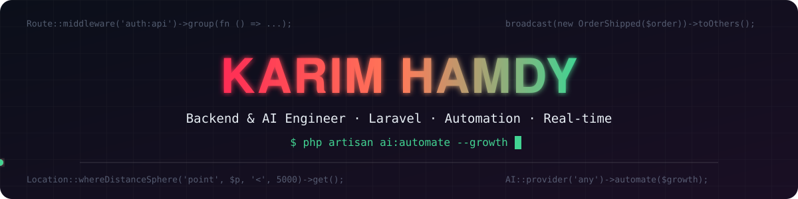
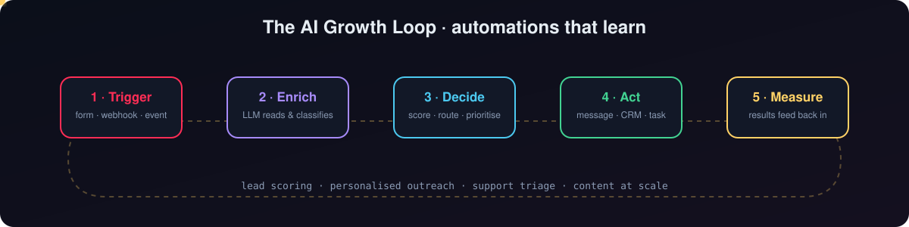
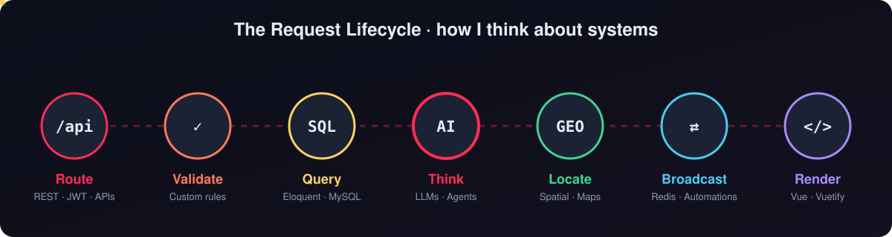
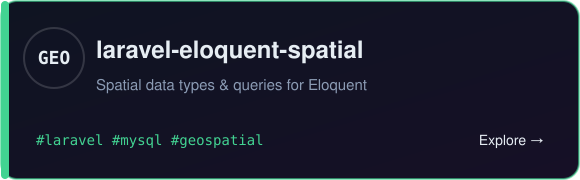
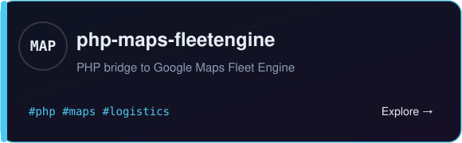
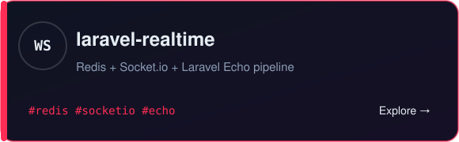
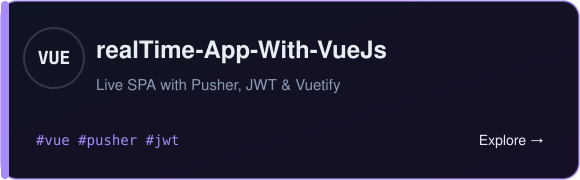
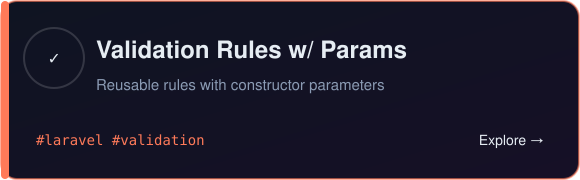
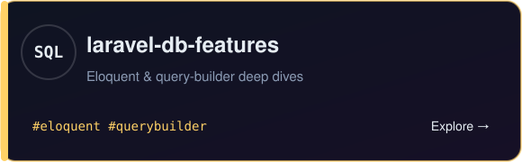

# Karim Hamdy: Backend & AI Engineering, Automation Flows, and Real-time Systems

**TL;DR:** I'm **Karim Hamdy**, a backend and AI engineer who builds with **Laravel and PHP**. I connect apps to **any AI provider** (OpenAI, Claude, Gemini, open-source and local models), design **automation flows** that run the boring parts of a business, and build **Growth AI** systems that score leads, personalise outreach and learn from results. Underneath it all are solid APIs, real-time events and location-aware data.

* **AI integrations**: One backend, any model, with fallbacks, cost tracking and clean abstractions.
* **Automation flows**: n8n, Make, Zapier, webhooks and custom Laravel pipelines.
* **Growth AI**: Lead scoring, AI-written outreach, chatbots and support triage.

* [laravel-eloquent-spatial](https://github.com/karim20160300/laravel-eloquent-spatial): Geospatial types and queries for Eloquent.
* [php-maps-fleetengine](https://github.com/karim20160300/php-maps-fleetengine): PHP access to Google Maps Fleet Engine.
* [laravel-realtime](https://github.com/karim20160300/laravel-realtime-using-redis-socket.io-and-laravel-echo): Redis, Socket.io and Laravel Echo, end to end.
* [realTime-App-With-VueJs](https://github.com/karim20160300/realTime-App-With-VueJs): A live single-page app with Pusher, JWT and Vuetify.

<p align="center">
  
  
  
  
  
  
  
  
</p>

<p align="center">
  <a href="https://github.com/karim20160300">
    
  </a>
</p>

<p align="center">
  <a href="#ai-integration-hub">AI Hub</a> ·
  <a href="#the-ai-growth-loop">Growth Loop</a> ·
  <a href="#the-request-lifecycle">Lifecycle</a> ·
  <a href="#featured-work">Featured work</a> ·
  <a href="#the-stack">Stack</a> ·
  <a href="#how-i-build">How I build</a> ·
  <a href="#github-pulse">Pulse</a> ·
  <a href="#lets-connect">Connect</a>
</p>

## AI integration hub

I treat AI models like any other service: behind a clean interface, swappable and measurable. Your app talks to one Laravel core; the core picks the right provider for the job, falls back if one fails, and tracks tokens and cost.



## The AI growth loop

Automations get smarter when results feed back into them. Every flow I build follows this loop: something happens, AI understands it, the system decides, acts, and measures what worked.



## The request lifecycle

Every project I build follows the path of a single request. It gets **routed**, **validated**, **queried**, passed through **AI** when it needs to think, **located**, **broadcast**, and finally **rendered**. Each stage is a place where I like to go deep.



<p align="center"><sub>Route · Validate · Query · Think · Locate · Broadcast · Render</sub></p>

## Featured work

<table>
<tr>
<td width="50%"><a href="https://github.com/karim20160300/laravel-eloquent-spatial"></a></td>
<td width="50%"><a href="https://github.com/karim20160300/php-maps-fleetengine"></a></td>
</tr>
<tr>
<td><a href="https://github.com/karim20160300/laravel-realtime-using-redis-socket.io-and-laravel-echo"></a></td>
<td><a href="https://github.com/karim20160300/realTime-App-With-VueJs"></a></td>
</tr>
<tr>
<td><a href="https://github.com/karim20160300/LaravelValidationRulesWithParamerrsOrLogic"></a></td>
<td><a href="https://github.com/karim20160300/laravel-db-features"></a></td>
</tr>
</table>

## The stack

| Layer | What I use | Why it matters |
| :--- | :--- | :--- |
| **AI providers** | OpenAI, Anthropic Claude, Google Gemini, Mistral, DeepSeek, Ollama | The right model for each task, with fallbacks |
| **AI engineering** | Prompt design, function calling, RAG, embeddings, agents | AI that uses your data and takes real actions |
| **Automation** | n8n, Make, Zapier, webhooks, Laravel queues | Workflows that run the business while you sleep |
| **Growth AI** | Lead scoring, AI outreach, chatbots, CRM sync | More leads handled with less manual work |
| **API** | Laravel, PHP, REST, JWT | Clean, versioned endpoints with real auth |
| **Data** | MySQL, Eloquent, Query Builder | Fast queries and models that read like English |
| **Location** | Spatial columns, Google Maps, Fleet Engine | Distance, geofencing and live vehicle tracking |
| **Real-time** | Redis, Socket.io, Laravel Echo, Pusher | Events that reach users the moment they happen |
| **Frontend** | Vue.js, Vuetify, TypeScript | Enough UI to ship the whole feature myself |
| **Foundations** | Java, ASP.NET, Linux, OS concepts | Scheduling, file systems and how machines think |

<p align="center">
  
  
  
  
  
  
  
  
</p>

<p align="center">
  
</p>

## How I build

<details>
<summary><strong>Any AI provider, one interface</strong></summary>

> [!TIP]
> The app should never care which model answered. Providers change; the interface doesn't.

```php
$reply = AI::using(config('ai.default'))      // openai, claude, gemini, ollama...
    ->fallback(['claude', 'gemini'])
    ->system('You are a sales assistant. Answer in JSON.')
    ->prompt($lead->message)
    ->json();

$lead->update(['score' => $reply['score'], 'intent' => $reply['intent']]);
```
</details>

<details>
<summary><strong>Automations that call AI, then act</strong></summary>

```php
// A new lead arrives from a form, WhatsApp or a webhook
Event::listen(LeadCreated::class, function ($e) {
    Pipeline::send($e->lead)
        ->through([EnrichWithAI::class, ScoreLead::class, SyncToCrm::class, SendFollowUp::class])
        ->thenReturn();
});
```
</details>

<details>
<summary><strong>Validation is a design tool, not an afterthought</strong></summary>

> [!TIP]
> Rules that take constructor parameters turn validation into reusable building blocks.

```php
$request->validate([
    'pickup' => ['required', new WithinServiceArea($city)],
    'seats'  => ['required', new AvailableSeats($trip)],
]);
```
</details>

<details>
<summary><strong>Location should be a first-class query</strong></summary>

```php
// Drivers within 5 km of the customer, nearest first
Driver::query()
    ->whereDistanceSphere('location', $customer->location, '<', 5000)
    ->orderByDistanceSphere('location', $customer->location)
    ->get();
```
</details>

<details>
<summary><strong>If it changed, the user should already know</strong></summary>

```php
// Server
broadcast(new TripUpdated($trip))->toOthers();
```
```js
// Client
Echo.private(`trips.${tripId}`).listen('TripUpdated', e => updateMap(e.trip));
```
</details>

## GitHub pulse

<p align="center">
  
  
</p>

<p align="center">
  
</p>

## Let's connect

<p align="center">
  <a href="https://www.linkedin.com/in/YOUR-LINKEDIN"></a>
  <a href="mailto:YOUR-EMAIL"></a>
  <a href="https://github.com/karim20160300?tab=repositories"></a>
</p>

<p align="center"><sub>Open to AI integration, automation and backend projects. If it can be automated, made smarter or updated live, I'm interested.</sub></p>
